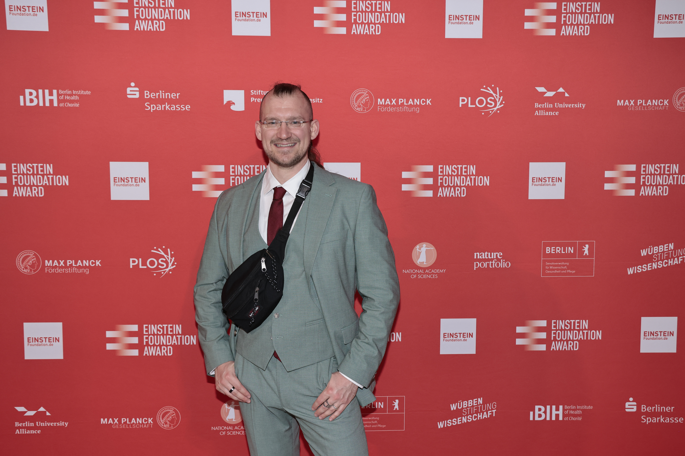
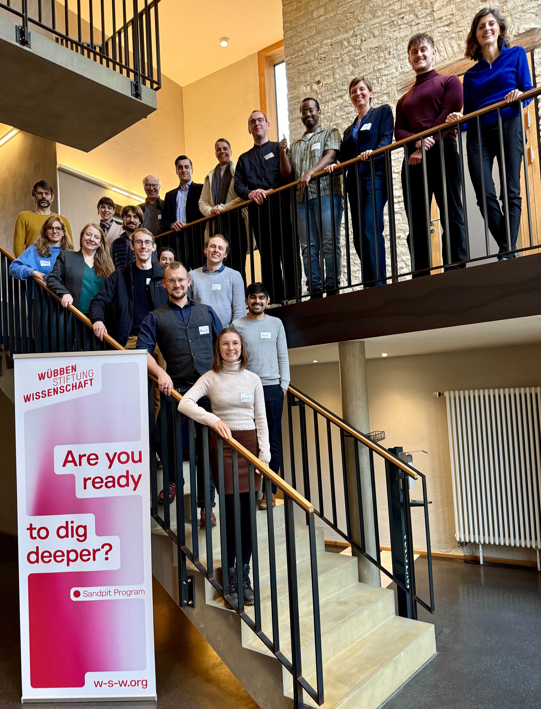
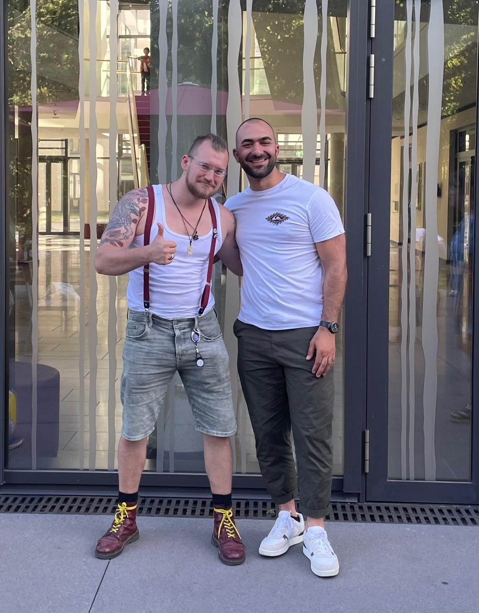
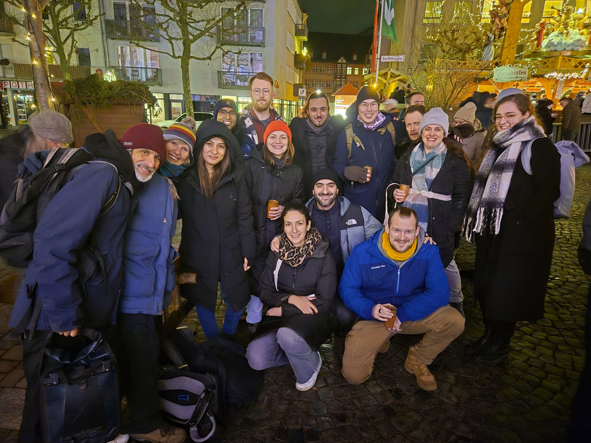
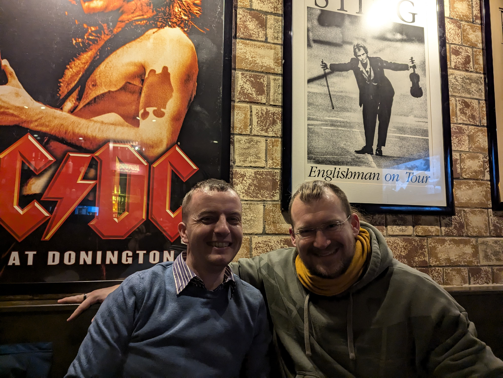
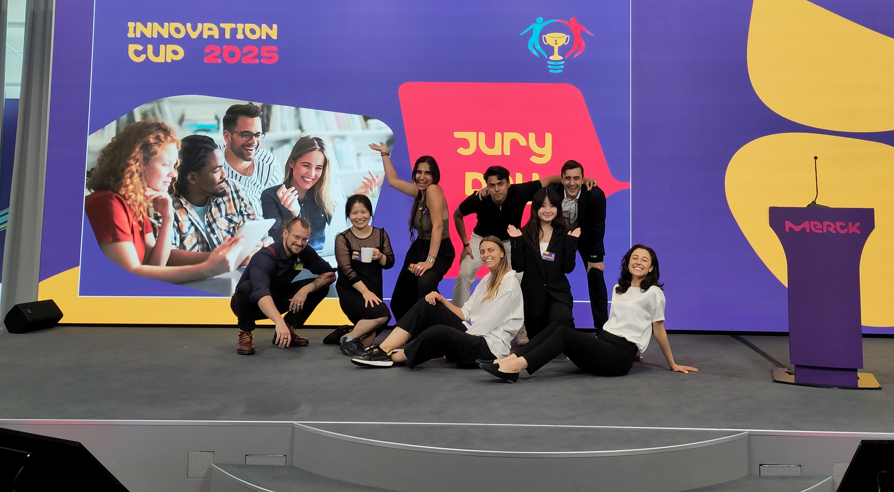
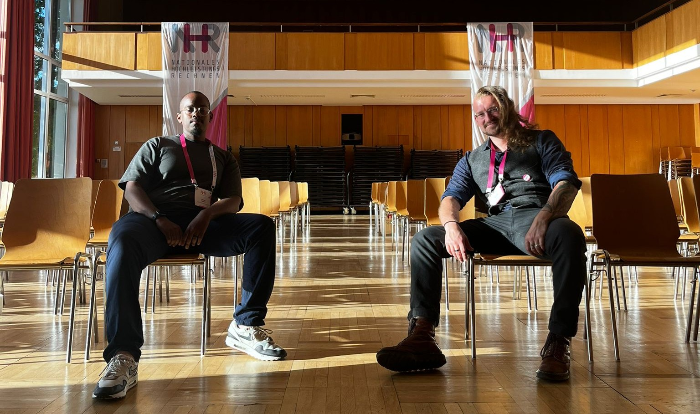
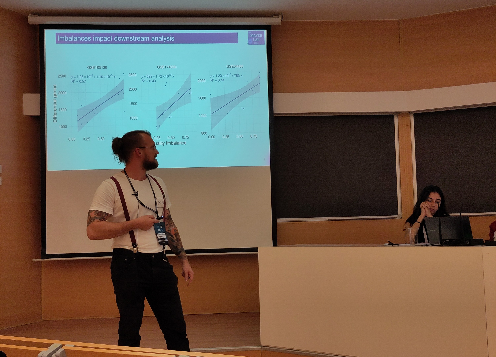
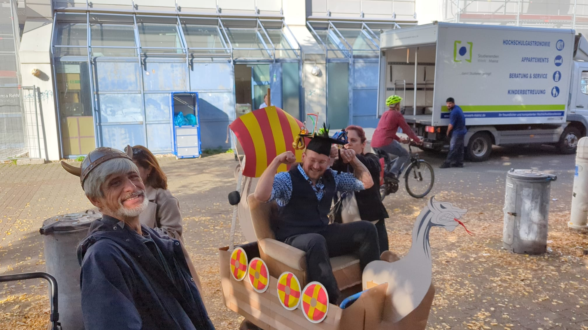

::: {.hero-banner}

# Sprang and Friends

Research, code, and ideas in computational biology — from data quality, generative AI for biosequences to biosecurity and beyond.

:::

```{=html}
<div id="heroCarousel" class="carousel slide carousel-fade" data-bs-ride="carousel" data-bs-interval="5000">
  <div class="carousel-indicators">
    <button type="button" data-bs-target="#heroCarousel" data-bs-slide-to="0" class="active"></button>
    <button type="button" data-bs-target="#heroCarousel" data-bs-slide-to="1"></button>
    <button type="button" data-bs-target="#heroCarousel" data-bs-slide-to="2"></button>
    <button type="button" data-bs-target="#heroCarousel" data-bs-slide-to="3"></button>
    <button type="button" data-bs-target="#heroCarousel" data-bs-slide-to="4"></button>
    <button type="button" data-bs-target="#heroCarousel" data-bs-slide-to="5"></button>
    <button type="button" data-bs-target="#heroCarousel" data-bs-slide-to="6"></button>
    <button type="button" data-bs-target="#heroCarousel" data-bs-slide-to="7"></button>
    <button type="button" data-bs-target="#heroCarousel" data-bs-slide-to="8"></button>
    <button type="button" data-bs-target="#heroCarousel" data-bs-slide-to="9"></button>
    <button type="button" data-bs-target="#heroCarousel" data-bs-slide-to="10"></button>
  </div>
  <div class="carousel-inner">
    <div class="carousel-item active">
      
      <div class="carousel-caption">
        <h5>Einstein Foundation ECR Award 2025</h5>
        <p>Dr. Maximilian Sprang</p>
        <small class="photo-credit">Photo: Sebastian Gabsch/Einstein Stiftung Berlin</small>
      </div>
    </div>
    <div class="carousel-item">
      
      <div class="carousel-caption">
        <h5>Einstein Foundation Award Ceremony</h5>
        <p>Early Career Researcher Award — "Erring Rigorously"</p>
        <small class="photo-credit">Photo: Sebastian Gabsch/Einstein Stiftung Berlin</small>
      </div>
    </div>
    <div class="carousel-item">
      
      <div class="carousel-caption">
        <h5>Sandpit Conference 2025</h5>
        <p>Generative AI for Biological Sequence Design: Opportunities, Challenges, and Responsible Innovation — W&uuml;bben Stiftung Wissenschaft</p>
      </div>
    </div>
    <div class="carousel-item">
      
      <div class="carousel-caption">
        <h5>AG Mayer at Mainzer Carnival</h5>
        <p>Science and Fastnacht — the Mainz way</p>
      </div>
    </div>
    <div class="carousel-item">
      
      <div class="carousel-caption">
        <h5>Max &amp; Mert</h5>
        <p>A Friend and Collaborator in computational genomics</p>
      </div>
    </div>
    <div class="carousel-item">
      
      <div class="carousel-caption">
        <h5>AG Andrade</h5>
        <p>The Mainz Computational Biology and Data Mining group</p>
      </div>
    </div>
    <div class="carousel-item">
      
      <div class="carousel-caption">
        <h5>Max &amp; David</h5>
        <p>A friend and former colleague at DFKI, David</p>
      </div>
    </div>
    <div class="carousel-item">
      
      <div class="carousel-caption">
        <h5>Merck Innovation Cup 2025</h5>
        <p>Coaching Team Digital Health</p>
      </div>
    </div>
    <div class="carousel-item">
      
      <div class="carousel-caption">
        <h5>Max &amp; Hassan</h5>
        <p>A friend and collaborator from the UK</p>
      </div>
    </div>
    <div class="carousel-item">
      
      <div class="carousel-caption">
        <h5>CIBB 2025</h5>
        <p>Presenting research at the conference in Milano</p>
      </div>
    </div>
    <div class="carousel-item">
      
      <div class="carousel-caption">
        <h5>PhD Defense 2024</h5>
        <p>With my Doktervater Miguel</p>
      </div>
    </div>
  </div>
  <button class="carousel-control-prev" type="button" data-bs-target="#heroCarousel" data-bs-slide="prev">
    <span class="carousel-control-prev-icon"></span>
    <span class="visually-hidden">Previous</span>
  </button>
  <button class="carousel-control-next" type="button" data-bs-target="#heroCarousel" data-bs-slide="next">
    <span class="carousel-control-next-icon"></span>
    <span class="visually-hidden">Next</span>
  </button>
</div>
```

::: {.grid style="margin-top: 2rem;"}

::: {.g-col-4}
::: {.card-section}
### People
Meet the team and our collaborators across Europe and beyond.

[Meet the team &rarr;](people/index.qmd)
:::
:::

::: {.g-col-4}
::: {.card-section .accent-violet}
### Research
Publications, active projects, and open science.

[Explore research &rarr;](research/index.qmd)
:::
:::

::: {.g-col-4}
::: {.card-section}
### Blog
Multi-author posts on methods, results, and ideas.

[Read the blog &rarr;](blog/index.qmd)
:::
:::

:::

::: {.grid style="margin-top: 1rem; margin-bottom: 2rem;"}

::: {.g-col-12}
::: {.card-section .accent-violet}
### Resources
Datasets, tools, and software we build and share with the community.

[Browse resources &rarr;](resources/datasets.qmd)
:::
:::

:::
