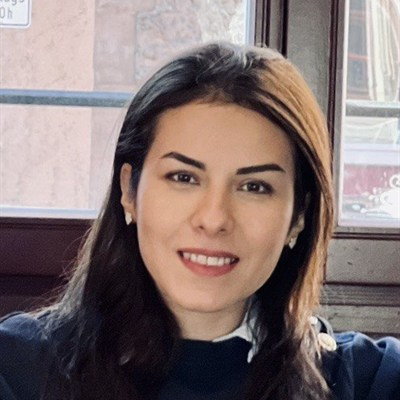

<!--
  Adding an alumna/alumnus: copy an alumni-entry block, use the headshot from
  images/profiles/thumbs/ (see scripts/make-headshot.ps1), and list joint papers under "Papers with the lab".
-->

::: {.alumni-entry}
::: {.grid}
::: {.g-col-12 .g-col-sm-3}
{.profile-photo fig-alt="Sara Farmahini"}
:::
::: {.g-col-12 .g-col-sm-9}
### Sara Farmahini

[**Now:** PhD student at the Bernhard Nocht Institute for Tropical Medicine, Hamburg]{.alumni-now}

Sara is a bioinformatician with a background in genetics and computational biology. Her research focuses on applying machine learning and deep learning to cancer immunotherapy, particularly the identification of tumor-specific T cell receptors (TCRs). Her Master's research combined cancer genomics, neoantigen prediction, immunological databases, and transformer-based models to investigate peptide–MHC–TCR interactions, with a focus on non-small cell lung cancer.
:::
:::
:::

::: {.alumni-entry}
::: {.grid}
::: {.g-col-12 .g-col-sm-3}
{.profile-photo fig-alt="Rashika Jakhmola"}
:::
::: {.g-col-12 .g-col-sm-9}
### Rashika Jakhmola

[Master's student · Internship]{.alumni-role}

[**Now:** PhD student in the MLO lab of Prof. Florian Büttner, University Medical Center of Goethe University Frankfurt]{.alumni-now}

Rashika worked on single-cell models and biologically informed neural networks for clinical omics data integration and prediction.

::: {.joint-papers}
**Papers with the lab**

- **R Jakhmola**, DA Selby, M Cihan, et al., JU Mayer, S Vollmer, C Martin, J Ewald, **M Sprang**. **MiracleNet: A biologically interpretable machine learning model for resected non-small-cell lung cancer.** *Computational and Structural Biotechnology Journal*, 2026. [DOI: 10.34133/csbj.0145](https://doi.org/10.34133/csbj.0145)
- DA Selby\*, **R Jakhmola**\*, **M Sprang**\*, et al. **Visible neural networks for multi-omics integration: a critical review.** *Frontiers in Artificial Intelligence* 8, 2025. [DOI: 10.3389/frai.2025.1595291](https://doi.org/10.3389/frai.2025.1595291)
:::
:::
:::
:::

[&larr; Back to People](index.qmd)
