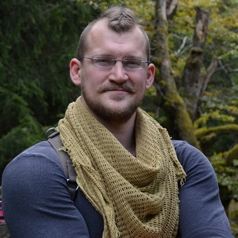
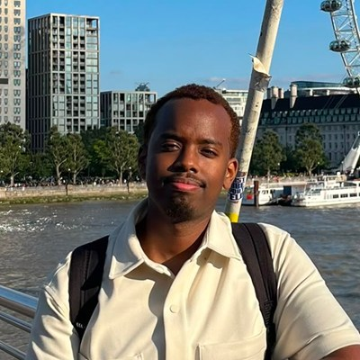
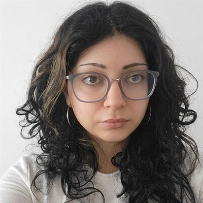
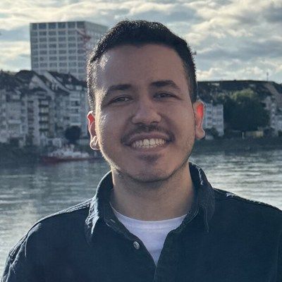
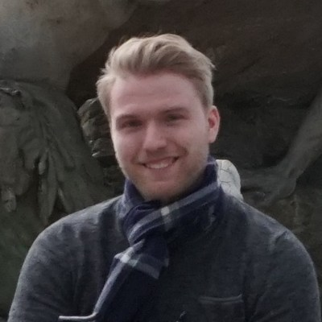

<!--
  Adding someone:
  1. Save their photo as images/profiles/name_surname.jpg
  2. Make a square headshot for the card:
       powershell -File scripts/make-headshot.ps1 images/profiles/name_surname.jpg -CenterX 0.5 -CenterY 0.3 -Zoom 1.5
  3. Copy a person-card block below into the right section and add people/surname.qmd for the bio and project.
     If they have papers with the lab, list them in a ::: {.joint-papers} block on their profile page.
  Former members go on alumni.qmd.
-->

## Team

::: {.grid}

::: {.g-col-12 .g-col-sm-6 .g-col-md-4 .g-col-lg-3}
::: {.person-card}
{.profile-photo fig-alt="Dr. Maximilian Sprang"}

### Dr. Maximilian Sprang

Junior Group Leader

[Full CV &rarr;](sprang.qmd)
:::
:::

::: {.g-col-12 .g-col-sm-6 .g-col-md-4 .g-col-lg-3}
::: {.person-card}
{.profile-photo fig-alt="Johannes Wolter"}

### Johannes Wolter

PhD student

Co-supervised with Prof. Miguel Andrade-Navarro

*Batch effect detection in bulk and single-cell data using representation learning*
:::
:::

::: {.g-col-12 .g-col-sm-6 .g-col-md-4 .g-col-lg-3}
::: {.person-card}
{.profile-photo fig-alt="Hassan Ahmed Hassan"}

### Hassan Ahmed Hassan

PhD student [Part-time]{.badge-role}

Also Senior Data Scientist, Hippo Digital (UK)

*Safe, general-purpose DNA and RNA foundation models*

[Profile & papers &rarr;](hassan.qmd)
:::
:::

::: {.g-col-12 .g-col-sm-6 .g-col-md-4 .g-col-lg-3}
::: {.person-card}
{.profile-photo fig-alt="Jasmin Brubach"}

### Jasmin Brubach

MD candidate

*Alternative polyadenylation in single-cell data of skin cancer*
:::
:::

::: {.g-col-12 .g-col-sm-6 .g-col-md-4 .g-col-lg-3}
::: {.person-card}
{.profile-photo fig-alt="Yasmin Mansour"}

### Yasmin Mansour

MD candidate

Scholarship holder, Else Kröner Promotionskolleg „ImmunYoAge“

*Alternative polyadenylation signatures in aging*
:::
:::

::: {.g-col-12 .g-col-sm-6 .g-col-md-4 .g-col-lg-3}
::: {.person-card}
{.profile-photo fig-alt="Giorgia D'Amico"}

### Giorgia D'Amico

M.Sc. student & student research assistant

*Generative AI for bacteriophage genomes*

[Profile &rarr;](damico.qmd)
:::
:::

::: {.g-col-12 .g-col-sm-6 .g-col-md-4 .g-col-lg-3}
::: {.person-card}
{.profile-photo fig-alt="Ayşe Nur Sevilmiş"}

### Ayşe Nur Sevilmiş

M.Sc. student & research assistant

*Protein language models for antibodies and T-cell receptors*

[Profile &rarr;](sevilmis.qmd)
:::
:::

::: {.g-col-12 .g-col-sm-6 .g-col-md-4 .g-col-lg-3}
::: {.person-card}
{.profile-photo fig-alt="Andrew George Zaki"}

### Andrew George Zaki

M.Sc. student

*Embedding search and sequence risk scoring to safeguard DNA synthesis*
:::
:::

:::

## External Students

::: {.grid}

::: {.g-col-12 .g-col-sm-6 .g-col-md-4 .g-col-lg-3}
::: {.person-card}
{.profile-photo fig-alt="Laurenz Kammeyer"}

### Laurenz Kammeyer

M.Sc. student, TU Darmstadt

*AI safety for generative models in biology*

[Profile &rarr;](kammeyer.qmd)
:::
:::

::: {.g-col-12 .g-col-sm-6 .g-col-md-4 .g-col-lg-3}
::: {.person-card}
{.profile-photo fig-alt="Laszlo Lang"}

### Laszlo Lang

B.Sc. student

Co-supervised with Prof. Asis Hallab

*Statistical batch-effect modelling for omics data*
:::
:::

:::

## Alumni

Former students and members of the lab are listed on the [alumni page &rarr;](alumni.qmd)

---

**Interested in joining?** We are always happy to hear from motivated students and researchers. Get in touch at [masprang@uni-mainz.de](mailto:masprang@uni-mainz.de).
