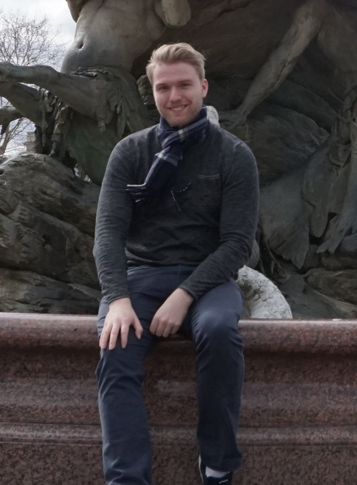

::: {.grid}

::: {.g-col-12 .g-col-md-4}
{.profile-portrait fig-alt="Laurenz Kammeyer"}
:::

::: {.g-col-12 .g-col-md-8}

## About

My name is Laurenz, I'm 26 years old, and I'm currently pursuing my Master's in Computer Science and Artificial Intelligence. In my free time, I enjoy working out, playing tennis and the piano, as well as volunteering as a firefighter. When I originally chose my degree, it was a close race between Computer Science and Physics. Ultimately, I decided to go with CS because of its hands-on accessibility. I consider myself a creative and curious person, so it was important to me to be able to actively develop my own ideas in my chosen field. While major breakthroughs in physics nowadays often require expensive labs and highly specialized equipment, in IT, you can build world-changing projects with just a laptop and a GitHub account. Driven by this passion for innovation, I am excited to contribute to the team's research.

## Project: AI safety for generative models in biology

Right now, I'm looking into how effective current AI safety methods are when applied to generative models in biology. Specifically, my research focuses on finding ways to prevent these models from generating harmful material. The goal is to modify the models so they can no longer be used to create, extend, or complete dangerous genetic sequences. To keep things entirely safe and avoid any exposure to actual toxic sequences, I am conducting my research using a proxy dataset made up of harmless enzymes.

:::

:::

[&larr; Back to People](index.qmd)
