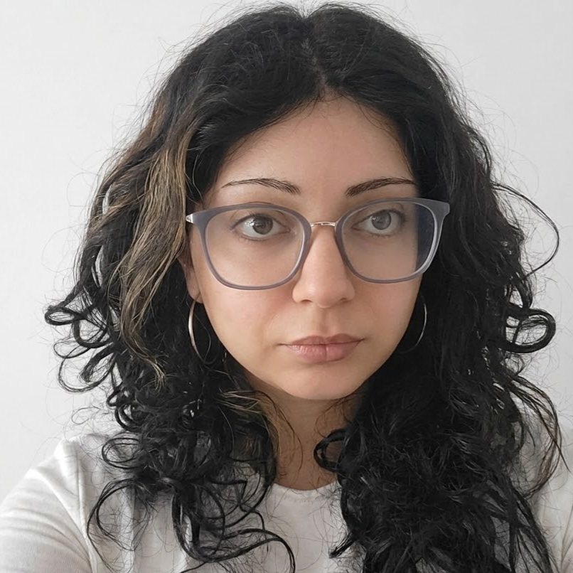

::: {.grid}

::: {.g-col-12 .g-col-md-4}
{.profile-portrait fig-alt="Ayşe Nur Sevilmiş"}
:::

::: {.g-col-12 .g-col-md-8}

## About

I'm currently doing my M.Sc. in Bioinformatics at Saarland University and working as a research assistant at Universitätsmedizin Mainz on machine learning models for the immune system. My focus is on protein language models for antibodies and T-cell receptors.

## Project: Protein language models for antibodies and T-cell receptors

Antibodies and T-cell receptors come from similar genetic processes, and have separate, domain-specific language models. Our current project tests whether knowledge carries over between domain-specific protein language models and how knowledge is captured in them in a benchmark against general-purpose protein language models.

:::

:::

[&larr; Back to People](index.qmd)
