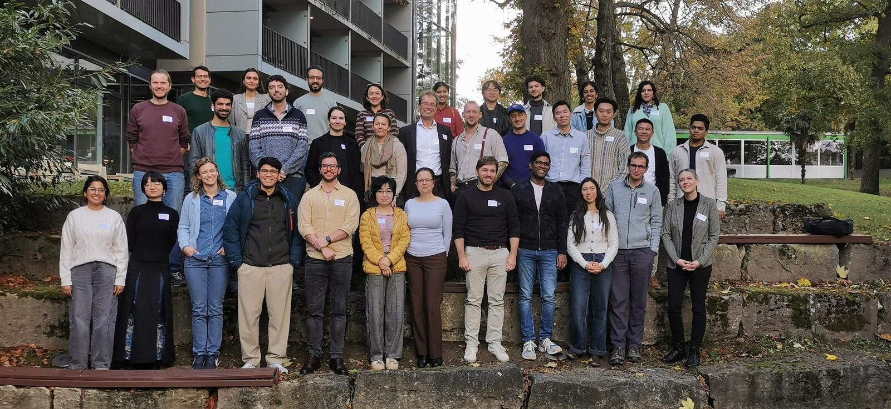
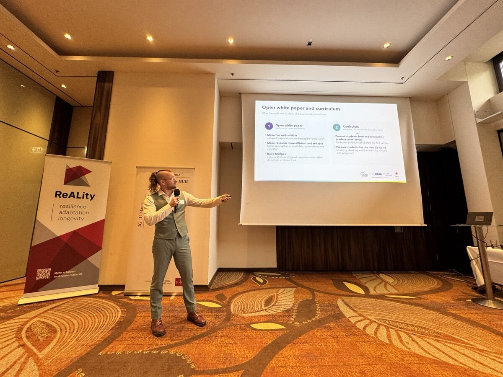
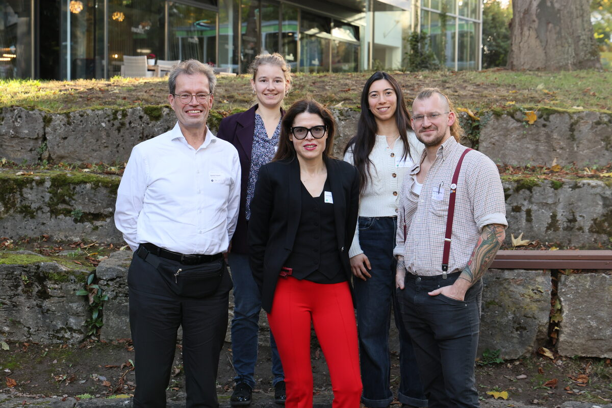

## SVITER

*Spatiotemporal Atlas of Vascular Inflammaging and Therapeutic Targeting of DPP4 for Endothelial Resilience*

SVITER asks whether an established class of diabetes drugs could help protect blood vessels as we age. The project centres on DPP4, an enzyme on the surface of endothelial and immune cells that cleaves, and thereby regulates, a broad range of inflammatory mediators such as interleukins, growth factors and cytokines. DPP4 inhibitors ("gliptins") are approved, widely prescribed and well tolerated, and there is growing evidence that blocking DPP4 reduces senescence and oxidative stress in the vasculature. In earlier work, the partner group in Anesthesiology showed that the DPP4 inhibitor sitagliptin protected small blood vessels from inflammation-related dysfunction in patients undergoing major surgery, with similar effects in mice. The group has also shown that distinct subtypes of brain endothelial cells respond differently to inflammation.

Building on this, the project has three aims:

1. **Map vascular ageing** by building an integrated single-cell atlas of how endothelial cells change with age across 11 tissues and different vessel types.
2. **Link cellular changes to outcomes** by connecting these age-related changes to measures of vascular and organ health.
3. **Test DPP4 as a therapeutic target** by determining how much DPP4 contributes to vascular resilience during ageing, and whether DPP4 inhibitors could become a strategy against age-related vascular decline.

SVITER is a collaboration between our lab, which contributes the bioinformatics, and the group of Dr. Miriam Julia Renz at the Department of Anesthesiology.

**Funding:** ReALity Initiative, Rhineland-Palatinate · **Period:** 2026–2028 · **PIs:** Dr. Maximilian Sprang (Department of Dermatology, contact) and Dr. Miriam Julia Renz (Department of Anesthesiology), University Medical Center Mainz

[More about SVITER on the ReALity Initiative website →](https://reality.uni-mainz.de/sviter-2/)

## Erring Rigorously

*On quantifying the impact of errors in the wet lab on downstream analysis*

Sequencing data are the backbone of modern biomedical research, but technical artefacts and batch effects introduced at the bench can blur the biological signal and lead to wrong conclusions. In earlier work we showed that differences in data quality between sample groups, a *quality imbalance*, affect more than 30% of public RNA-seq datasets, including clinical studies ([Genome Biology, 2024](https://doi.org/10.1186/s13059-024-03331-6)). Most of the field deals with such problems after the fact, by filtering or correcting the data. Erring Rigorously goes to their source and asks which steps in the wet lab actually introduce them, and how much each one matters.

To find out, we make mistakes on purpose. Starting from a clean ground-truth experiment, wild-type versus knock-out cells from the same stock under optimal conditions, we perturb the same workflow at defined stages:

- **Cell culture:** higher passage numbers and different confluency at splitting
- **RNA:** controlled degradation to different levels of RNA integrity
- **Handling:** a parallel workflow run by a different person, to create a realistic batch effect
- **Library preparation:** poly-A enrichment, rRNA depletion and long-read protocols

For every sample we measure quality with our machine-learning tool [seqQscorer](https://doi.org/10.1186/s13059-021-02294-2) and follow the effect through differential expression analysis, to see which perturbations distort the biological signal and which leave it intact.

The project will produce a fully annotated, openly shared dataset that pairs a known biological comparison with known technical errors: a benchmark for testing batch-effect correction and normalisation methods, and for refining seqQscorer. It also tackles a broader question: does poor technical quality always rule out meaningful biological insight, or can imperfect data still be useful once its biases are understood? Wet-lab work is carried out with partner labs, while our lab leads the bioinformatics and machine learning.

**Funding:** Einstein Foundation Award for Promoting Quality in Research, Early Career category (2025) · **Period:** 2026–2027

[About the project on the Einstein Foundation website →](https://award.einsteinfoundation.de/award-winners-finalists/recipients-2025/erring-rigorously) · [Einstein Foundation podcast episode with Max Sprang →](https://www.einsteinfoundation.de/aktuelles/details/can-bad-genomic-data-make-science-better)

## AIxBio: Frontiers and Futures

*From shared blind spots to a new curriculum for teaching at the interface of AI and the biosciences*

{.project-photo fig-alt="Group photo of the workshop participants standing on garden steps in autumn" group="aixbio"}

AI is changing bioscience research quickly, but computational and experimental scientists still often talk past each other: different research cultures, disciplinary boundaries and unsolved methodological problems get in the way of real collaboration. AIxBio: Frontiers and Futures starts from those open problems rather than from finished results, and turns them into teaching.

**Workshop (October 2026).** On 27 and 28 October 2026, the workshop "AI in Bioscience: Converging Interests and Joint Solutions" brought PhD candidates and postdocs from bioscience and AI together in Mainz with keynote speakers and industry representatives. Every participant contributed a "Blind Spot": a dataset they don't know how to model, or an algorithm still looking for a bioscience use case. These were presented as posters throughout the workshop and then taken up in small breakout groups, which worked through shared challenges such as biological data analysis, model validation and interpretability, and translating computational advances into experimental practice.

**Student retreat (2027).** Next year, a retreat takes the clustered blind spots, the breakout-group results and a literature search from the workshop, and translates the problems and solutions into the key skills the next generation of quantitative bioscientists will need. The goal is a community-driven white paper on the future of bioscience teaching and a concrete new curriculum.

The project is led by Max Sprang, with Nicole Johnstone (University of St Andrews, Scotland) as co-lead.

::: {.grid .project-photo-pair}
::: {.g-col-12 .g-col-md-6}
{.project-photo fig-alt="Max Sprang presenting a slide titled Open white paper and curriculum, next to a ReALity banner" group="aixbio"}
:::
::: {.g-col-12 .g-col-md-6}
{.project-photo fig-alt="The five members of the organising team in the hotel garden" group="aixbio"}
:::
:::

[Photos: IQCB]{.photo-credit .project-credit}

**Partners:** Institute for Quantitative and Computational Biosciences (IQCB), ReALity Initiative, JGU Scotland HUB × Scottish Universities Life Sciences Alliance (SULSA) · **Funding:** Ministry of Science, Further Education and Health of Rhineland-Palatinate and the Scottish Government, through the Rhineland-Palatinate & Scotland Life Sciences Partnership · **Period:** 2026–2027

[Workshop photos on the IQCB website →](https://iqcb.uni-mainz.de/events/ai-in-bioscience-2026-photos)

::: {.callout-note}
More projects will follow soon.
:::
